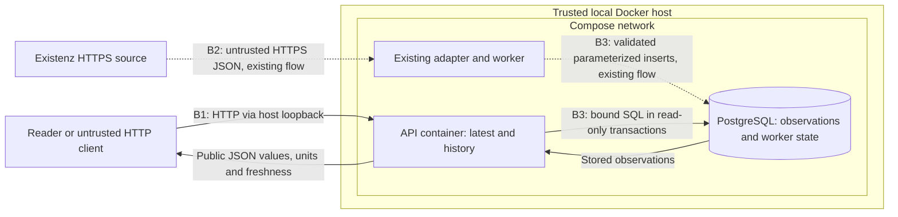

# Measurement API threat model

Reviewed on 2026-11-04 against feature commit `99f3768`, which adds `GET /latest`
and `GET /history`. This document formalizes the model **after implementation**,
following the initial focused threat analysis. It records the final controls and
verification evidence; it is not evidence that a full documented model existed
before coding.

The method follows the decomposition, threat identification, mitigation, and
validation approach in the [OWASP Threat Modeling Cheat Sheet](https://cheatsheetseries.owasp.org/cheatsheets/Threat_Modeling_Cheat_Sheet.html),
using STRIDE as prompts for relevant scenarios. The source was consulted on
2026-11-04. Priorities below reflect prerequisites and consequences in this
application, rather than numerical risk scores.

## Scope and deployment assumptions

The reviewed change exposes stored hydrological observations through two public
read routes in [app/measurements.py](../app/measurements.py). The [API contract](api.md)
defines validation, response fields, errors, units, and freshness. Existing
ingestion and `/health` are context for this model, not a new exhaustive audit of
the worker, containers, CI, or dependencies.

The implemented deployment is local Docker Compose:

- [compose.yaml](../compose.yaml) publishes the API on host loopback
  `127.0.0.1`; PostgreSQL has no published host port.
- API, worker, and migrations share the configured PostgreSQL identity. Compose
  does not define a separate API role with restricted grants.
- The application container uses the non-root application user defined in the
  [Dockerfile](../Dockerfile). Container and host administration remain trusted.
- There are no accounts, sessions, tenants, private user records, or public write
  operations. Anyone able to reach the API is intentionally allowed to read the
  same public observations.
- API reads do not call Existenz, initiate ingestion, or accept a target URL.
  They do not give callers an outbound request capability.

Internet hosting, a reverse proxy, TLS termination, request-rate enforcement,
production database roles, and the provider's network controls are **not
implemented or verified by this feature**. Local exposure limits which attackers
can reach the routes; it does not make HTTP inputs trustworthy. No production
security or load-capacity conclusion follows from this review.

## Assets and actors

The protected assets are API/database availability, the integrity of stored
measurements and their timestamps, correct communication of uncertainty and units,
database credentials, and the separation between application processes and the
host. Measurement values are public; credentials and internal exception details
are not. Misleading an API consumer about freshness or a swimming indicator can
matter even when no confidential data is involved.

| Actor | Legitimate access or attacker prerequisite | Relevant capability |
| --- | --- | --- |
| Reader or future dashboard | Reachable HTTP API | Read public values and history; no identity or ownership boundary to cross |
| Maintainer | Trusted access to the checkout and Docker host | Configure credentials, run migrations and services, inspect data |
| Untrusted HTTP client | Currently requires access to the local listener; an Internet deployment would broaden reach | Supply arbitrary query strings, repeat requests, choose dense valid windows |
| Compromised upstream or upstream publisher | Ability to influence the response served by the configured Existenz source | Supply malformed observations, or false observations that satisfy structural checks |
| Compromised application process | Separate code-execution or credential compromise, not demonstrated by these routes | Use the shared database identity outside the intended route transaction |

## Data flow and trust boundaries

**B1: caller to API.** Query values cross from an untrusted client into parsing,
range checks, SQL arguments, and JSON serialization. Lack of authentication is
intentional for these public reads. Absence of cross-origin middleware is not
authentication or protection against direct HTTP requests.

**B2: source to ingestion.** HTTPS transport does not establish the truth of a
measurement. The existing [adapter](../app/source.py) checks envelope structure,
station/parameter identity, numeric and finite values, and timestamp bounds. It
also bounds response size; the [worker](../app/worker.py) uses network timeouts
and retries failed series on later cycles. There are no calibrated physical
plausibility thresholds or independent observation-authenticity checks.

**B3: processes to database.** Parameterized queries and database constraints
protect intended operations. The API explicitly starts read-only transactions,
but the processes share a database identity. That identity is not a least-privilege
boundary between API, ingestion, and migrations. PostgreSQL's unexposed host port
does not prevent access by a compromised authorized process on the Compose network.

## Threats, priorities, and responses

The date-conversion defect below was confirmed and corrected during feature
verification. The other scenarios describe plausible abuse paths and residual
architectural risks; they are not claims of demonstrated exploitation. Evidence
IDs refer to the verification inventory in the next section.

| Asset / flow | Scenario and prerequisites | Existing controls | Likelihood, impact, priority | Control added by the feature | Effective verification | Residual risk / assumption |
| --- | --- | --- | --- | --- | --- | --- |
| T1: history input parsing; denial of service | A reachable caller sends an aware timestamp whose UTC conversion exceeds Python's representable date range | Datetime parsing and the intended 30-day bound | Easy input to construct; an uncaught exception caused a request failure. Correct before delivery | Validate the allowed interval before converting to UTC | E1: both extreme dates return 422; E2 includes live HTTP checks | Fixed in this feature. A sustained outage or process crash was not demonstrated |
| T2: SQL access; tampering and disclosure | A caller injects SQL into station, parameter, or date values, or attempts a write method | Database station/parameter and finite-value constraints | Inputs are attacker-controlled; successful injection could expose or alter data. Essential route constraint | Station/parameter allowlist, aware date validation, bound SQL arguments, GET-only routes, read-only transactions | E1: malicious inputs rejected before connection; write methods return 405; code inspection confirms binding and transaction mode | No injection identified. Transaction mode does not restrict a compromised process using a new connection; API-only grants remain a deployment concern |
| T3: per-request database and response work; denial of service | A caller requests very old history or a dense valid series | Composite primary key; existing 3-second connection and 5-second statement timeouts | Straightforward without bounds; potentially excessive database and response work. Essential route constraint | Last 30 days only; SQL returns at most 5,001 rows and rejects more than 5,000 points; latest performs six lateral lookups with `LIMIT 1` | E1: exact time bounds, 5,000/5,001 cap and ordering; E2/E3: live reads and bounded latency sample | Result caps do not bound every internal database operation or total concurrent work. Connection and query timeouts are not an overall HTTP deadline |
| T4: shared service capacity; denial of service | A reachable client floods otherwise valid requests, opening repeated database connections | Localhost publication limits current reach | Exploit threshold unmeasured; sustained traffic could deny service. Review before Internet exposure | Per-request controls from T3 reduce work, but no flood-specific control was added | E3 covers sequential requests only; no concurrent flood test | No request-rate limit or proven concurrent-capacity budget. Public ingress and connection/concurrency limits require deployment decisions |
| T5: internal information in failures; disclosure | A client makes requests while the database or measurement schema is unavailable | Existing bounded database connection handling | Database outages are plausible; uncensored exceptions could reveal internals. Required failure behavior | Catch PostgreSQL errors and return a fixed generic 503, without logging the exception or connection details in the new routes | E1: refused database connection, exact generic body, then recovery | Tests cover connection failure; not every database failure mode or future proxy/error handler. No claim that arbitrary exceptions are globally sanitized |
| T6: upstream observations; tampering or source spoofing | An attacker controls the upstream response, or an upstream defect supplies false but structurally valid values | Fixed HTTPS source, validation of types/finite values/series/time window, database constraints and idempotency | Requires upstream influence; could corrupt the public interpretation of real conditions. Preserve source uncertainty; review when adding sources or indices | API retains source units, timestamps and explicit missing/stale states; reads do not introduce another source path | E1 tests presentation; E4 exercises malformed upstream data, finite checks and retry behavior with mocked HTTP | A plausible finite value is not verified as physically correct. No independent source comparison or calibrated physical range check; HTTPS does not resolve this |
| T7: interpretation of conditions; business-logic misuse | A reader or downstream consumer treats absent/stale values, turbidity units, or provisional indices as reassurance about swimming | Six known series and original catalog units; existing independent health signals | Misinterpretation is plausible and can have serious consequences. Required product constraint before exposing indices | Missing observations remain null; stale/future values are marked; freshness is per series; both indices remain unavailable with reasons and an explicit warning | E1: zero versus missing, independent timestamps, freshness boundaries, future values, unavailable indices and warning | Clients may ignore metadata. Thirty minutes is operational, not a safety threshold; BSTU/NTU, visual contrast and calibration remain unresolved |

### Confirmed defect: extreme timezone conversion

Initially, history normalized the parsed date to UTC before checking the allowed
interval. Inputs such as `0001-01-01T00:00:00+01:00` and
`9999-12-31T23:59:59-01:00` can exceed the datetime representation during that
conversion. The final implementation checks the allowed range first, rejecting
these requests with 422 before database access. Regression inputs are in
`test_history_rejects_invalid_inputs_before_accessing_database`.

This is a corrected input-handling vulnerability, distinct from the untested
possibility of sustained resource exhaustion. No claim is made that those inputs
could crash the worker, corrupt data, or provide code execution.

## Verification inventory and limits

These are results already obtained during the feature's implementation on
2026-11-04 and reused for this model. Writing this document did not rerun them.
Code and test mappings were reviewed against `99f3768`.

| Evidence | Recorded result and reproducible source | What it establishes / limit |
| --- | --- | --- |
| E1: deterministic application suite | 100 passing tests with real isolated PostgreSQL in Docker, plus Ruff lint and formatting checks. Includes 52 cases in [tests/test_measurements.py](../tests/test_measurements.py) | Route behavior, input boundaries, original units, missing and stale states, caps, generic DB failure/recovery, GET-only methods, and schema. HTTP requests use ASGI transport; this is not a public load test |
| E2: live server smoke checks | Uvicorn with migrations and PostgreSQL, without worker/public-source requests: empty results, extreme dates returning 422, and a 24-hour request returning 144 synthetic points | The read paths also work through a live HTTP server with empty and populated storage; not a complete deployment or ingestion observation |
| E3: local latency sample | 25,920 synthetic rows, six series, 30 days at ten-minute intervals; 100 sequential requests after 10 warmups: median 6.617 ms, p95 7.785 ms, maximum 10.109 ms | Sample for the less-than-100-ms `/latest` target only in that environment. Persistent client and Uvicorn loopback inside the API container, separate PostgreSQL container; no concurrency, Internet latency, or production sizing proof. Details in [api.md](api.md#verification) |
| E4: existing ingestion and health tests in E1 | [tests/test_source.py](../tests/test_source.py), [tests/test_worker.py](../tests/test_worker.py), [tests/test_persistence.py](../tests/test_persistence.py), and [tests/test_health.py](../tests/test_health.py) | Mocked upstream rejection, bounds, idempotency, backfill, outage recovery and independent freshness. No public source truth validation or continuous 24-hour run |
| E5: existing scanner runs | Bandit: zero findings; pip-audit: no known vulnerabilities reported for the audited packages; Gitleaks: no leaks reported across 10 commits | Supporting evidence for their specific rule sets, dependency inventory, advisory state, and scanned Git history. They do not validate business logic, operating-system packages, runtime privilege isolation, or absence of all secrets |

The regular suite command is documented in [api.md](api.md#verification) and uses
[compose.test.yaml](../compose.test.yaml). Scanner commands and coverage are in
the [README](../README.md#security-checks). No dependency or workflow change was
needed for the API feature. Scanner results are not substitutes for this model
or the independent security review required by the repository.

The GET-only tests establish that public write methods are rejected and leave
measurements unchanged. Read-only SQL transaction mode was verified by inspecting
the route code, not by a dedicated test of database-role grants. Internet
transport security, request floods, production database permissions, and a
continuous 24-hour worker observation remain unverified.

## Design decisions and alternatives

- Keeping reads separate from ingestion avoids making source outages or network
  responses part of a caller's synchronous request. The trade-off is explicit
  freshness metadata rather than an assumption of live data.
- A fixed window and row cap are sufficient for the MVP chart contract. The API
  rejects dense overflow explicitly instead of silently truncating or adding
  pagination/aggregation with new semantics. Revisit that decision if actual
  source cadence prevents useful windows.
- Bound SQL arguments prevent input from becoming SQL structure. Read-only
  transactions add protection for intended statements. A separately granted API
  database role would contain a compromised process more effectively; the shared
  local identity does not provide that control.
- A future ingress proxy could enforce request rates and concurrent work without
  adding another application service. Application-level limits are another
  option. Neither is implemented or proven here; a choice needs deployment and
  measured traffic context. Adding Redis or caching is not required by this model.
- Withholding the indices avoids manufacturing calibrated meaning from available
  values. Turning them on requires validated units and thresholds, not merely
  fresh input. No index may establish swimming permission or guarantee safety.

Repudiation and cross-user authorization were considered: there is no
state-changing user workflow, account identity, or private per-user resource in
this feature. No artificial account or audit-log requirement is added. New
identity, ownership, or write operations would change that conclusion.

## Revisit criteria and follow-up ownership

Before Internet exposure, the maintainer and deployment/security reviewer should
update this model for the actual provider and ingress. Confirm TLS termination,
network reachability, required origins, production credentials and separated
database permissions; select and verify request-rate/concurrency controls and
failure observability without sensitive logging. Test expected concurrent traffic
and failure behavior in that environment. These are review criteria, not changes
implemented or an approval granted by this feature.

Revisit B1/T2/T4/T5 if authentication, private data, cross-origin clients, or write
routes are introduced. Revisit B2/T6 when source URLs, adapter validation, source
cadence, or retention change. When building the dashboard, revisit T7 to preserve
safe rendering, units, timestamps and freshness metadata, and keep the indices
explicitly unavailable. Building that dashboard does not require calibrated
indices. Before activating an index, resolve its unit questions, validate the
relationship to the claimed phenomenon, and calibrate thresholds with appropriate
domain evidence; Jonction specifically requires resolving BSTU/NTU and validating
visual contrast.

The maintainer still needs the MVP's 24-hour worker observation. Future changes
to Docker privileges, database identities, ingress, or dependency/workflow policy
also require a fresh review of the affected boundaries. The current evidence
supports the scoped local read API; it does not establish that the entire project
is secure or ready for production.
